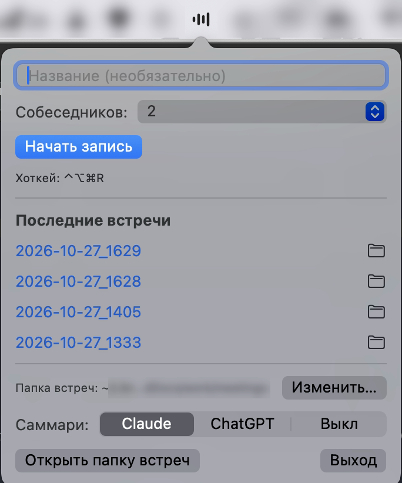

# MeetRec

Записывает звонки на Mac (Google Meet, Zoom, Telegram и любые другие) и превращает их в текст.

Ваш голос и голоса собеседников пишутся раздельно, поэтому в транскрипте видно, кто что сказал. Распознавание работает прямо на Mac, аудио никуда не уходит. По желанию Claude или ChatGPT делает короткое саммари: о чем договорились и кто что делает.



## Установка

Нужен Mac на Apple Silicon с macOS 14.5 или новее.

```
xcode-select --install
git clone git@github.com:ngoman/meet-rec.git
cd meet-rec
./install.sh
```

Первая команда ставит инструменты разработчика, если их еще нет. Без SSH-ключа на GitHub клонируйте по https: `git clone https://github.com/ngoman/meet-rec.git`.

Установщик сам поставит все нужное, скачает модель распознавания (около 550 MB) и спросит, куда складывать записи.

## Первый запуск

macOS попросит несколько разрешений, дайте все:

- микрофон;
- уведомления;
- системный звук: Системные настройки > Конфиденциальность и безопасность > Запись экрана и системного звука > «Только системный звук», включить MeetRec.

Без доступа к системному звуку в записи будет только ваш голос.

## Как пользоваться

- **Ctrl+Option+Cmd+R** начинает и останавливает запись.
- Иконка MeetRec (четыре полоски) в строке меню открывает панель с кнопкой записи, последними встречами и настройками.
- После остановки запись обрабатывается в фоне. Когда все готово, придет уведомление «Транскрипт готов», клик по нему откроет текст.

В панели рядом с названием выбирается «Собеседников: N». По умолчанию 1: все собеседники подписаны одним именем. Если в звонке несколько человек, выберите их число (2-6) или «Авто», и в транскрипте будут «Собеседник 1», «Собеседник 2» и так далее. Выбор можно менять и во время записи, он запоминается. Голоса различаются автоматически и иногда ошибаются.

Саммари: в панели переключатель «Claude / ChatGPT / Выкл». Для Claude нужен Claude Code с подпиской, для ChatGPT нужен Codex CLI и вход в подписку ChatGPT (`codex login`). Текст встречи при этом уходит в Anthropic или OpenAI.

Каждая встреча сохраняется в отдельную папку:

- `transcript.md` текст встречи;
- `summary.md` саммари;
- `audio.m4a` звук.

По умолчанию папки лежат в `~/Documents/MeetRec`. Сменить место можно в панели кнопкой «Изменить…». Чтобы записи синхронизировались между устройствами, выберите папку внутри iCloud Drive.

Предупреждайте участников, что встреча записывается.

## Если что-то не так

- **Не видно иконки.** Строка меню переполнена, и иконка спряталась за вырезом экрана. Зажмите Cmd и перетащите лишние значки из строки меню.
- **В транскрипте нет собеседников.** Проверьте разрешение на системный звук (см. «Первый запуск»).
- **Слова собеседников появляются в ваших репликах.** Без наушников микрофон слышит динамики. Говорите в наушниках.
- **Нет саммари.** Для него нужен Claude Code с подпиской или Codex CLI со входом в ChatGPT (`brew install --cask codex`, `codex login`). Без них все остальное работает, а саммари можно выключить в панели.

## Обновление и удаление

Приложение раз в сутки проверяет обновления на GitHub Releases. При включенной галочке «Автообновление» в панели новая версия скачивается и ставится сама, приложение при этом перезапускается, когда нет записи и обработки, а Mac пару минут простаивает. Если галочка выключена, проверка все равно идет и в панели появляется кнопка «Обновить». Кнопка «Проверить» ищет обновление сразу.

Вручную:

```
git pull && ./install.sh
```

Установка, сделанная до появления автообновления, обновляется так один раз, и macOS один раз спросит разрешения заново. Дальше разрешения сохраняются между версиями.

Удаление:

```
./uninstall.sh
```

Удаление не трогает записи встреч.

Команды терминала, настройки, модели и прочие подробности: [docs/DETAILS.md](docs/DETAILS.md).
